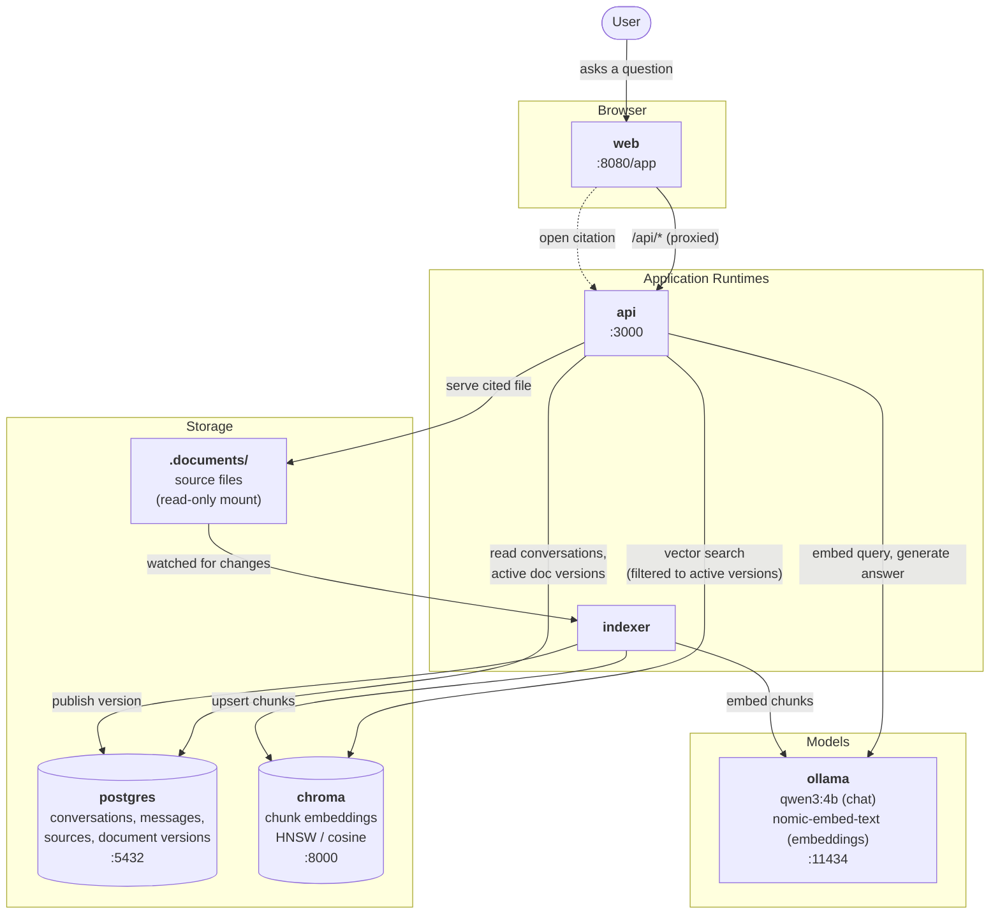
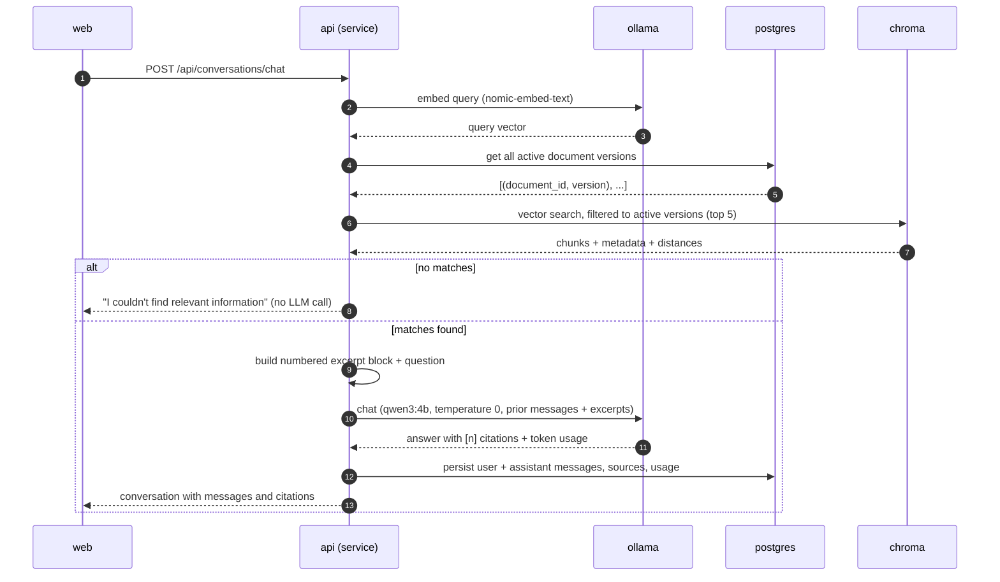
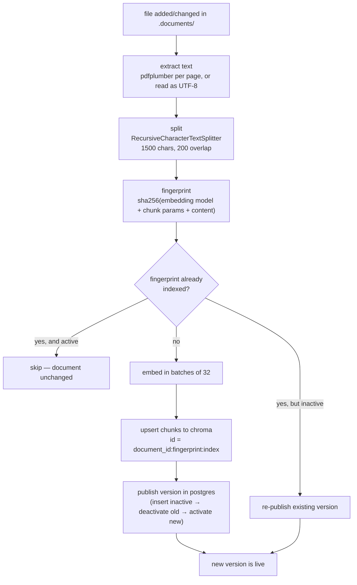

<div align="center">

[](https://github.com/kieranroneill/docssistant/blob/main/LICENSE)

</div>

<h1 align="center">
  Docssistant
</h1>

<p align="center">
    Docssistant is a document chat assistant that uses retrieval-augmented generation (RAG) to answer questions about your documents and cite its sources.
</p>

<p align="center">
    
</p>

<p align="center">
    <sub>Every claim carries a <code>[n]</code> citation; each source resolves to a file and page, and opens the original document.</sub>
</p>

---

### Table of contents

- [1. Overview](#-1-overview)
  - [1.1. Architecture](#11-architecture)
  - [1.2. Components](#12-components)
  - [1.3. How a question is answered](#13-how-a-question-is-answered)
  - [1.4. How a document is indexed](#14-how-a-document-is-indexed)
  - [1.5. Project structure](#15-project-structure)
- [2. Getting started](#-2-getting-started)
  - [2.1. Requirements](#21-requirements)
  - [2.2. Running the stack](#22-running-the-stack)
  - [2.3. Adding your own documents](#23-adding-your-own-documents)
  - [2.4. Service endpoints](#24-service-endpoints)
  - [2.5. Shutting down and resetting](#25-shutting-down-and-resetting)
- [3. Development](#-3-development)
  - [3.1. Requirements](#31-requirements)
  - [3.2. Local tooling](#32-local-tooling)
  - [3.3. Tests, linting and formatting](#33-tests-linting-and-formatting)
- [4. Appendix](#-4-appendix)
  - [4.1. Useful commands](#41-useful-commands)
  - [4.2. Configuration](#42-configuration)
  - [4.3. Database migrations](#43-database-migrations)
- [5. How to contribute](#-5-how-to-contribute)
- [6. License](#-6-license)

## 🔭 1. Overview

Docssistant is split into two independent runtimes over shared storage: an **indexer** that turns files on disk into embedded, versioned chunks, and an **API** that answers questions by retrieving those chunks and passing them to a chat model. Neither calls the other — they only meet at Postgres and Chroma. That boundary is deliberate: indexing is slow, bursty and restartable, whereas answering a question needs to be fast and stateless.

Everything runs locally. The chat and embedding models are served by Ollama in a container, so no document content or question ever leaves the machine.

<sup>[Back to top ^][table-of-contents]</sup>

### 1.1. Architecture



<sup>[Back to top ^][table-of-contents]</sup>

### 1.2. Components

Each box above is a Compose service defined in [`deployments/compose.development.yml`](./deployments/compose.development.yml), built from a Dockerfile in [`build/package/`](./build/package).

#### `web` — the chat interface

A React 19 + TypeScript single-page app built with Vite and styled with Tailwind CSS v4. It is served under the `/app` base path and talks to the API through Vite's dev-server proxy, so the browser only ever sees same-origin `/api/*` requests and there is no CORS configuration to maintain.

The UI renders a conversation, streams nothing (responses are returned whole), and shows each assistant message's citations as footnote-style links. Clicking a citation hits `GET /api/documents/{document_id}`, which returns the original file so the user can check the claim against the source. Code is organised by feature (`web/src/conversation/`) over a shared platform layer (`web/src/platform/`); the conventions are documented in [AGENTS.md](./AGENTS.md).

#### `api` — retrieval and generation

A FastAPI application using a strict three-layer split: routes handle HTTP, services hold the application logic, and repositories own persistence. Long-lived clients (Chroma, Postgres, the chat and embedding agents) are constructed once in the app's `lifespan` and attached to `app.state`, then handed to services through FastAPI dependencies — so a service never constructs its own I/O and can be tested against a fake.

It exposes conversation CRUD, the two chat entrypoints (start a new conversation, or continue an existing one), and the document-serving endpoint used by citations.

#### `indexer` — ingestion

A standalone worker. It performs one full indexing pass at startup and then watches `.documents/`, re-running the pass (debounced) whenever a supported file changes. Supported extensions are `.md`, `.pdf` and `.txt`.

Running ingestion as a separate process rather than an upload endpoint keeps slow, failure-prone work off the request path: a malformed PDF or a cold embedding model degrades indexing without affecting anyone who is mid-conversation.

#### `ollama` — model serving

Serves both models the system needs: `qwen3:4b` for chat and `nomic-embed-text` for embeddings. The container's entrypoint pulls each model on first boot if it isn't already present, so there is no manual setup step — but the first `make dev` will take several minutes while it downloads.

Models persist to `.ollama/` on the host, so subsequent starts are fast.

Keeping chat and embeddings behind one interface means swapping either model is a config change (`OLLAMA_CHAT_MODEL` / `OLLAMA_EMBEDDING_MODEL`) rather than a code change. Changing the embedding model changes the chunk fingerprint, which triggers a clean re-index automatically — see [§1.4](#14-how-a-document-is-indexed).

#### `chroma` — vector store

Holds one collection (`document_chunks_nomic_v1`, cosine distance, HNSW index) of chunk embeddings. Each chunk carries `document_id`, `version`, `source`, `chunk_index` and, for PDFs, `page_number` as metadata. The version in the metadata is what makes safe, atomic re-indexing possible: new chunks are written alongside the old ones and only become visible when their version is published.

The collection name encodes the embedding model, so switching models means a new collection rather than a corrupted mix of incompatible vectors.

#### `postgres` — system of record

Stores conversations, their messages, each message's citations, and per-message token usage — plus the `document_versions` table that decides which chunks in Chroma are live. Accessed through SQLAlchemy's async engine; schema changes are paired with Alembic revisions in [`migrations/versions/`](./migrations/versions).

Postgres is the authority on _which_ version of a document is active, and Chroma is the index of _content_. Splitting it this way means a transactional guarantee (exactly one active version per document) lives in the store that can actually provide it.

#### `libs/` — shared code

Infrastructure and domain code used by both the API and the indexer: `libs/agents/` (chat and embedding clients behind abstract base classes), `libs/chroma/`, `libs/postgres/`, `libs/documents/` (chunk and version DTOs and repositories), `libs/logging/`, `libs/defaults/` (the `BaseService` / `BaseRepository` / `BaseController` classes features extend) and `libs/application/` (cross-cutting enums, errors and dependency providers).

The abstract agent classes (`AbstractChatAgent`, `AbstractEmbeddingsAgent`) are the seam for swapping providers: an OpenAI or Bedrock implementation slots in without touching a service.

<sup>[Back to top ^][table-of-contents]</sup>

### 1.3. How a question is answered



A few decisions worth calling out:

**Retrieval is always filtered.** The Chroma query is constrained to the `(document_id, version)` pairs Postgres reports as active, and the repository deliberately returns nothing rather than falling back to an unfiltered search when there are no active versions. A fallback would silently expose staged or superseded chunks; returning nothing is the safer failure.

**Weak matches are discarded before they become context.** A nearest-neighbour search has no concept of "no answer" — asked something the corpus cannot support, it still returns its five closest chunks. Matches beyond a maximum cosine distance (`MAX_MATCH_DISTANCE` in `libs/documents/constants.py`) are therefore dropped, which is what gives the system the ability to recognise an unanswerable question at all. The threshold is deliberately permissive: its job is to reject the clearly irrelevant, not to make fine-grained relevance judgements.

**No matches means no model call.** If retrieval comes back empty — because nothing matched, or because everything that matched was too distant — the service returns a fixed message and never invokes the LLM, so the model is never given the opportunity to answer from parametric memory. This is the cheapest and most reliable guardrail against unsourced answers.

**Context is assembled by the application, not the model.** Matches are formatted into a numbered block — `[1] handbook.pdf, page 12` followed by the chunk text — and appended to the user's question. The citation numbers the model is asked to use are the same numbers the application assigned, so every `[n]` in the answer maps back to a concrete chunk, page and file. Those mappings are persisted per message, which is what lets the UI turn a citation into a link to the source file.

**The system prompt treats excerpts as untrusted.** Retrieved text is explicitly framed as reference material whose instructions must not be followed, which blunts prompt injection carried inside an indexed document. It also instructs the model to say when the excerpts don't support an answer.

**Temperature is 0.** For a question-answering tool over a fixed corpus, reproducibility is worth more than variety.

**Conversation history is replayed in full.** Continuing a conversation re-sends its prior messages along with fresh excerpts for the new question. This is simple and correct for short conversations, and is the first thing that will need attention as they grow — see [§1.4](#14-how-a-document-is-indexed) for the known limits.

<sup>[Back to top ^][table-of-contents]</sup>

### 1.4. How a document is indexed



**Chunking.** 1500 characters with 200 of overlap, split recursively on paragraph and sentence boundaries. PDFs are split _per page_ first, so a chunk never straddles a page and every chunk can carry a real page number for citation — the citation quality is the reason for the per-page pass, not the text quality. Plain text and Markdown have no page concept and are split as a single stream. These values are currently hardcoded (`indexer/services.py`) and are the most obvious thing to tune.

**Content-addressed versioning.** A document's identity is a UUIDv5 of its path, and its version is a sha256 fingerprint over the embedding model name, the chunk parameters and the chunk content. So an unchanged file is a no-op on every pass, a changed file produces a new version, and changing the embedding model or chunk size invalidates everything automatically. Chunk ids embed the fingerprint, which means two versions of a document coexist in Chroma without colliding.

**Atomic publish.** A new version is inserted as inactive, the previous active version is deactivated, and the new one is activated — in one transaction, rolled back on failure. Combined with the version filter on retrieval, a reader either sees the old version in full or the new version in full, never a mixture of the two mid-index.

**Deletion.** Each pass reconciles active versions against the filesystem and deactivates any whose file has disappeared. Chunks are left in Chroma rather than deleted, since they are already unreachable through the version filter; reclaiming that space is deferred work.

#### Known limits

These are acknowledged rather than solved:

- **No upload endpoint.** Documents are provided by placing them in `.documents/`; there is no UI for adding them.
- **Fixed top-5 retrieval**, with no re-ranking, query rewriting or hybrid keyword search. The distance threshold is a blunt instrument tuned by eye against one embedding model, not a measured one.
- **Citations are requested, not enforced.** The application assigns the numbers, but nothing validates that the `[n]` markers in an answer correspond to sources that were actually supplied.
- **Unbounded query length.** `ChatRequest` sets a minimum but no maximum, and no timeout is set on either Ollama call.
- **Unbounded context growth.** Full conversation history plus fresh excerpts will eventually exceed the model's context window; there is no summarisation or truncation strategy.
- **Chunk orphans.** Superseded chunks are never garbage-collected from Chroma.
- **PDF text extraction only.** Scanned PDFs without a text layer yield nothing (the indexer logs a warning and keeps the previous version); there is no OCR, and tables lose their structure.
- **No evaluation harness.** Retrieval and answer quality are assessed by hand, not measured.
- **Single-user, no auth.** Every conversation is visible to every visitor.

<sup>[Back to top ^][table-of-contents]</sup>

### 1.5. Project structure

```text
.
├─ .documents/                              <-- Raw documents that are indexed by the indexer
│   └── ...
├─ api/                                     <-- API source files - uses a functional layering approach
│   ├── <package_name>/
│   │   └── ...
│   ├── main.py                             <-- Entrypoint file
│   └── ...
├─ build/
│   ├── package/                            <-- Docker image files
│   │   ├── <service-name>/
│   │   │   ├── Dockerfile
│   │   │   └── Dockerfile.development
│   │   └── ...
│   └── ...
├─ deployments/                             <-- Container orchestration configurations
│   ├── compose.development.yml
│   ├── compose.test.yml
│   └── ...
├─ indexer/                                 <-- Indexer worker - scans for documents and indexes them
│   ├── main.py                             <-- Entrypoint file
│   └── ...
├─ libs/                                    <-- Library source files - uses a functional layering approach
│   ├── <package_name>/
│   │   └── ...
│   └── ...
├─ migrations/                              <-- Alembic migrations
│   ├── versions/
│   │   ├── 19700101000000_create_a_table.py
│   │   └── ...
│   └── ...
├─ test/                                    <-- Pytest unit and integration suites
│   ├── integration/
│   ├── mocks/
│   ├── unit/
│   └── ...
├─ web/                                     <-- Web UI source files
│   ├── src/
│   │   └── main.ts                         <-- Entrypoint file
│   └── ...
├── commitlint.config.ts                    <-- Commitlint configuration
├── dev-requirements.txt                    <-- Python development dependencies
├── LICENSE                                 <-- Project license
├── Makefile                                <-- Make commands
├── package.json                            <-- JavaScript dependencies for tools and web UI
├── pip-requirements.txt                    <-- Defines the pip version
├── prettier.config.ts                      <-- Prettier configuration for formatting JS/TS files
├── pyproject.toml                          <-- Python project configuration file
├── README.md
├── requirements.txt                        <-- Python dependencies
└── ...
```

<sup>[Back to top ^][table-of-contents]</sup>

## 🪄 2. Getting started

### 2.1. Requirements

- [Docker](https://docs.docker.com/engine/install/) with Compose v2 (`docker compose`).
- An **NVIDIA GPU** with the [container toolkit](https://docs.nvidia.com/datacenter/cloud-native/container-toolkit/latest/install-guide.html) installed. The `ollama` service reserves one GPU, so the stack will not start without it. To run CPU-only, remove the `deploy.resources` block from the `ollama` service in [`deployments/compose.development.yml`](./deployments/compose.development.yml) — expect answers to take tens of seconds.
- Roughly **6 GB of free disk space** for the two Ollama models, plus space for Postgres and Chroma data.

Nothing else needs to be installed to run the stack — every service builds and runs in Docker. Node and Python are only needed for local tooling, covered in [§3](#-3-development).

<sup>[Back to top ^][table-of-contents]</sup>

### 2.2. Running the stack

Configuration is already committed: [`.env.dev`](./.env.dev) holds working development defaults, so there is no environment file to create. See [§4.2](#42-configuration) if you want to change anything.

1. Apply the database migrations. This starts Postgres on its own and creates the schema:

   ```bash
   make migrations_upgrade_dev
   ```

2. Build and start every service:

   ```bash
   make dev
   ```

   On the **first** run this also downloads `qwen3:4b` and `nomic-embed-text`, which takes several minutes. The API waits for Chroma, Ollama and Postgres to report healthy before it starts, so the logs will sit quiet for a while — this is expected. Models are cached in `.ollama/`, so later starts are quick.

3. Once the `web` service is up, open:

   ```text
   http://localhost:8080/app
   ```

   The repository ships with one sample PDF in `.documents/`, which the indexer will have picked up on startup — so you can ask a question immediately.

   

> ⚠️ **NOTE:** Run the migrations _before_ `make dev`. The indexer performs its first indexing pass at startup, and if the schema doesn't exist yet that pass fails and logs an error. It will recover on the next file change, but it is simpler to migrate first.

<sup>[Back to top ^][table-of-contents]</sup>

### 2.3. Adding your own documents

Copy any `.md`, `.pdf` or `.txt` file into the `.documents/` directory:

```bash
cp ~/my-handbook.pdf .documents/
```

The indexer is watching that directory and will pick the file up within a couple of seconds, chunk it, embed it and publish it. Follow its progress with:

```bash
docker logs -f docssistant_indexer_dev
```

Editing a file re-indexes it and removing one takes it out of retrieval, both automatically. Unchanged files are skipped on every pass, so restarting is cheap. Subdirectories are scanned recursively.

<sup>[Back to top ^][table-of-contents]</sup>

### 2.4. Service endpoints

| Service      | URL                               | Notes                                               |
| ------------ | --------------------------------- | --------------------------------------------------- |
| `web`        | http://localhost:8080/app         | The chat interface.                                 |
| `api`        | http://localhost:3000             | REST API.                                           |
| `api` docs   | http://localhost:3000/docs        | Auto-generated OpenAPI documentation.               |
| `api` health | http://localhost:3000/healthcheck | Used by the Compose healthcheck.                    |
| `chroma`     | http://localhost:8000             | Vector store.                                       |
| `ollama`     | http://localhost:11434            | Model serving.                                      |
| `postgres`   | `localhost:5432`                  | `postgres` / `password` / `docssistant` by default. |

<sup>[Back to top ^][table-of-contents]</sup>

### 2.5. Shutting down and resetting

Stop the stack with `Ctrl+C`, then remove the containers:

```bash
docker compose -f ./deployments/compose.development.yml --env-file .env.dev -p docssistant-dev down
```

State lives in gitignored directories on the host: `.chroma/` (embeddings), `.postgres/` (conversations and document versions) and `.ollama/` (downloaded models). Deleting `.chroma/` and `.postgres/` gives you a clean slate — re-run the migrations afterwards, and the indexer will rebuild the index from `.documents/` on next start. Keep `.ollama/` unless you want to download the models again.

<sup>[Back to top ^][table-of-contents]</sup>

## 🛠️ 3. Development

### 3.1. Requirements

In addition to the [runtime requirements](#21-requirements):

- [Python](https://www.python.org/downloads/) 3.12+
- [Node](https://nodejs.org/en/download) 24+
- [pnpm](https://pnpm.io/installation) 10.3.0

<sup>[Back to top ^][table-of-contents]</sup>

### 3.2. Local tooling

Install the JavaScript dependencies and create the Python virtual environment in `.venv`:

```bash
make install
```

This is needed for linting, formatting, the test suites and the Git hooks — not to run the application. Source code is bind-mounted into the `api`, `indexer` and `web` containers, so `make dev` hot-reloads all three as you edit.

The frontend can also be run directly against a stack started with `make dev`:

```bash
pnpm dev
```

<sup>[Back to top ^][table-of-contents]</sup>

### 3.3. Tests, linting and formatting

```bash
make test_py_unit         # fast, no containers needed
make test_py_integration  # starts postgres, chroma and the api via compose.test.yml
make test                 # both suites
make lint_py              # flake8
make format               # isort + black + prettier
```

Type-check the frontend with:

```bash
pnpm exec tsc --noEmit --incremental false -p web/tsconfig.json
```

Pull request CI runs Flake8 and both Python suites. Git hooks are managed by Husky and enforce formatting and conventional commit messages — please keep them enabled.

<sup>[Back to top ^][table-of-contents]</sup>

## 📑 4. Appendix

### 4.1. Useful commands

| Command                                                      | Description                                                      |
| ------------------------------------------------------------ | ---------------------------------------------------------------- |
| `make create_migration MESSAGE="create conversations table"` | Autogenerates an Alembic revision from SQLAlchemy model changes. |
| `make dev`                                                   | Builds and runs the whole platform via Docker Compose.           |
| `make format`                                                | Formats all source files.                                        |
| `make format_js`                                             | Formats JavaScript, TypeScript and Markdown files with Prettier. |
| `make format_py`                                             | Formats Python files with isort and Black.                       |
| `make install`                                               | Installs all dependencies, including development dependencies.   |
| `make install_js_deps`                                       | Installs the JavaScript dependencies.                            |
| `make install_py_deps`                                       | Installs the Python application dependencies.                    |
| `make install_py_dev_deps`                                   | Installs the Python development dependencies.                    |
| `make lint`                                                  | Lints all source files.                                          |
| `make lint_py`                                               | Lints Python source files with Flake8.                           |
| `make migrations_downgrade_dev`                              | Rolls back the latest migration (development).                   |
| `make migrations_upgrade_dev`                                | Applies all pending migrations (development).                    |
| `make test`                                                  | Runs the integration and unit suites.                            |
| `make test_integration`                                      | Runs all integration tests.                                      |
| `make test_py_integration`                                   | Runs the Python integration tests via Docker Compose.            |
| `make test_py_unit`                                          | Runs the Python unit tests.                                      |
| `make test_unit`                                             | Runs all unit tests.                                             |

<sup>[Back to top ^][table-of-contents]</sup>

### 4.2. Configuration

[`.env.example`](./.env.example) documents every supported variable; [`.env.dev`](./.env.dev) and [`.env.test`](./.env.test) are the committed development and test values. They contain no secrets — the Postgres password is a local default and should not survive into any real deployment.

The variables most worth knowing:

| Variable                 | Default                    | Description                                                                                          |
| ------------------------ | -------------------------- | ---------------------------------------------------------------------------------------------------- |
| `OLLAMA_CHAT_MODEL`      | `qwen3:4b`                 | The chat model. Pulled automatically on first start.                                                 |
| `OLLAMA_EMBEDDING_MODEL` | `nomic-embed-text`         | The embedding model. Changing it invalidates the index and forces a re-index.                        |
| `CHROMA_COLLECTION`      | `document_chunks_nomic_v1` | Chroma collection name. Encodes the embedding model, so change it alongside.                         |
| `LOG_LEVEL`              | `DEBUG`                    | `DEBUG` logs the assembled prompt and retrieved excerpts, which is useful when inspecting retrieval. |
| `API_PORT`               | `3000`                     | Host and container port for the API.                                                                 |

Compose supplies in-container hostnames (`api`, `chroma`, `ollama`, `postgres`) itself, so the `*_HOST` values in the `.env` files are only used when connecting from the host.

<sup>[Back to top ^][table-of-contents]</sup>

### 4.3. Database migrations

Database migrations are managed with [Alembic](https://alembic.sqlalchemy.org/en/latest/) and run through Docker, so they use the same environment as the API service.

```bash
make create_migration MESSAGE="add conversations table"
make migrations_upgrade_dev
make migrations_downgrade_dev
```

- `create_migration` generates a new Alembic revision from SQLAlchemy model changes.
- `migrations_upgrade_dev` applies all pending migrations.
- `migrations_downgrade_dev` rolls back the latest migration by one revision.

Always review both the `upgrade` and `downgrade` halves of a generated revision before committing it — autogenerate is a starting point, not an answer.

> ⚠️ **NOTE:** The `MESSAGE` argument is required when creating a migration because it becomes the migration description.

<sup>[Back to top ^][table-of-contents]</sup>

## 👏 5. How to contribute

Please read the [**contributing guide**](./CONTRIBUTING.md) to learn about the development process.

<sup>[Back to top ^][table-of-contents]</sup>

## 📄 6. License

Please refer to the [LICENSE](./LICENSE) file.

<sup>[Back to top ^][table-of-contents]</sup>

<!-- links -->

[table-of-contents]: #table-of-contents
